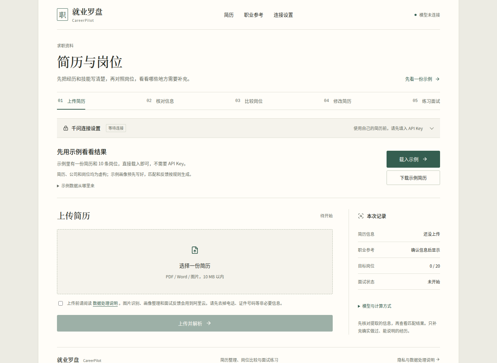
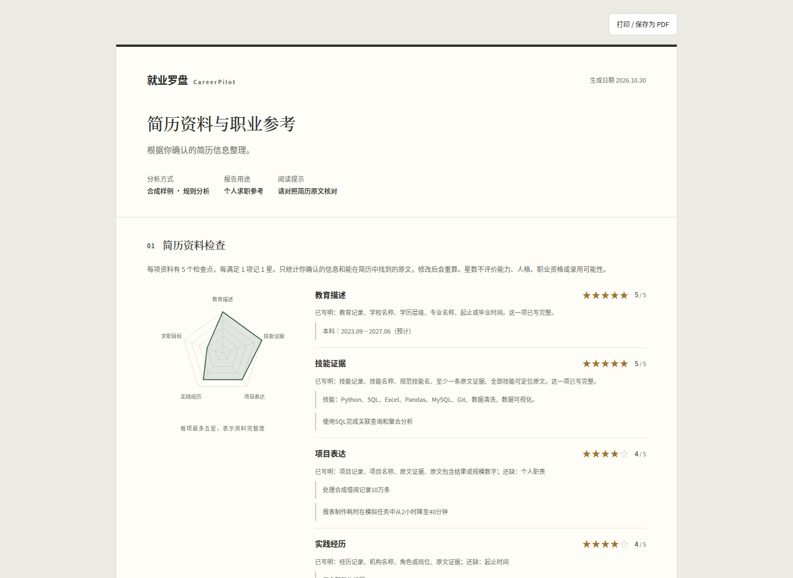

# CareerPilot · 就业罗盘

整理简历、对照岗位要求、练习面试并下载记录。模型功能使用阿里云百炼 / 千问 API，不需要部署模型。

[在线演示](https://7e950176.r39.cpolar.top) · [公开源码](https://github.com/CP-bee-git/AI-game) · [开发者说明](docs/DEVELOPMENT.md)



<details><summary>查看生成报告样式（合成样例）</summary>



</details>

## 启动网站

环境：Linux、Python 3.12+、Node.js 24+、pnpm 11。

```bash
git clone https://github.com/CP-bee-git/AI-game.git
cd AI-game
./start.sh
```

启动器自动安装依赖、构建网页并在后台运行 API 和网站。打开 **http://127.0.0.1:3000**，展开「千问连接设置」，填写阿里云百炼的 **Model Studio API Key**，验证成功即可使用；不是阿里云 AccessKey ID / Secret。

- 默认中国大陆节点、`qwen-plus`；也可选择新加坡节点，Key 与地域必须对应。
- 图片和扫描 PDF 使用同一 Key 调用 `qwen-vl-plus`；可选文字 PDF / DOCX 在应用中解析。
- 页面填写的 Key 仅保存在服务端临时内存，按浏览器会话隔离，不进入浏览器持久存储、数据库或 Git；会话最长 8 小时，服务重启后需重新连接。
- 没有 Key 也能点击「合成样例」体验完整操作；样例画像、诊断和面试明确为预置/规则演示，不冒充云模型结果。
- 真实简历的画像、诊断和面试需要有效 Key、相应模型权限与可用云额度；云 API 按阿里云实际计费。

若希望服务器预设 Key，可将 `.env.example` 复制为私有 `.env`，只填 `DASHSCOPE_API_KEY`。此默认 Key 会供该网站访客使用，不建议在开放演示中预设；通常直接在页面连接更合适。

## 用 cpolar 免费发布

```bash
./scripts/install-cpolar.sh
```

在 [cpolar 官网免费注册](https://dashboard.cpolar.com/signup)，登录控制台复制 authtoken。创建私有配置并填写 `CPOLAR_AUTHTOKEN`：

```bash
umask 077
cp .env.example .env  # 已有 .env 时不要重复覆盖
# 编辑 .env，只填写自己的 CPOLAR_AUTHTOKEN
./start.sh --public
```

启动器通过 cpolar 免费随机域名只发布网站的 3000 端口，打印 HTTPS 地址；网页 API 经同域代理访问，8000 不直接对公网开放。API Key 与 cpolar authtoken 是两种不同凭证。

免费域名不是固定域名，可能变化；应用电脑和 cpolar 进程需要持续联网运行。未提供 authtoken 时，程序会明确提示，网站仍可本机使用，不会声称公网发布成功。免费账号和套餐说明见 [cpolar 官方页面](https://www.cpolar.com/pricing)。

## 使用流程

1. 连接云 API，或载入完全虚构的演示样例。
2. 阅读数据处理说明，上传 PDF / DOCX / PNG / JPG（最大 10 MB）。
3. 生成并确认画像，查看五维星级与职业库匹配的 **10 个具体职业方向**；也可自行导入 1–20 条目标岗位。
4. 查看匹配分数、匹配依据和技能缺口，针对岗位生成诊断。
5. 完成多轮文本模拟面试，下载画像、诊断和面试的 HTML / JSON 报告；HTML 含星图，可打印为 PDF。

岗位分数使用可解释的技能、学历、城市规则，**不是语义向量相似度或录用概率**。系统不验证学历或材料真伪，不代投简历；反馈需人工判断。

职业方向来自 **O*NET® 31.0 开放职业库的 55 条精选快照**，保留真实职业代码、原文与来源（CC BY 4.0）。这是职业方向探索，不是实时招聘库；中文名为项目翻译。画像星级表示资料与原文证据完整度，不是能力测评。

## 维护与验证

```bash
make stop          # 停止网站、API 和本项目 cpolar 隧道
make setup         # 只安装依赖
make smoke         # 云错误分类、业务闭环、职业来源和报告检查
make check         # Python 编译、前端类型检查与生产构建
make e2e           # 桌面/手机与配置界面浏览器测试
python3 scripts/manage.py status
```

真实 Key 调用失败时按页面错误码检查地域、额度与权限；开发者可运行 `.venv/bin/python backend/scripts/smoke_flow.py --real` 做一次小额真实 JSON 诊断。未提供真实 Key 时，不会把模拟通过视为账户已验通。

首次运行浏览器测试需 `pnpm --dir frontend exec playwright install chromium`。运行日志在 `.runtime/logs/`；上传文件与业务结果在 `backend/storage/`，均不提交 Git。会话隔离只适合单实例演示；数据库和上传文件持久化，但重启后会话索引会清除，需重新上传；尚无自动删除/保留期管理，公开站点请使用合成或脱敏资料。

```text
backend/app/       FastAPI、云 API、简历处理与 SQLite 业务状态
frontend/app/      Next.js 中文求职工作台与数据处理说明
scripts/           一键启动、停止与 cpolar 安装
.env.example       可选的私有配置模板
```

演示数据集中在 `backend/app/data/china_demo.json`：候选人、学校、公司、岗位和结果数字均为虚构。能力类别参考教育部公开教学标准，原始链接及访问日期保留在数据的 `sources` 中；不打包第三方全文、不代表真实招聘。
