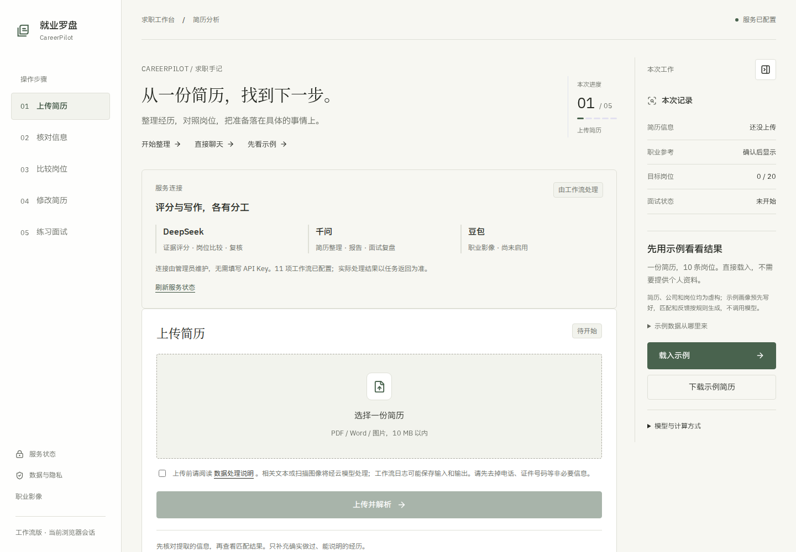
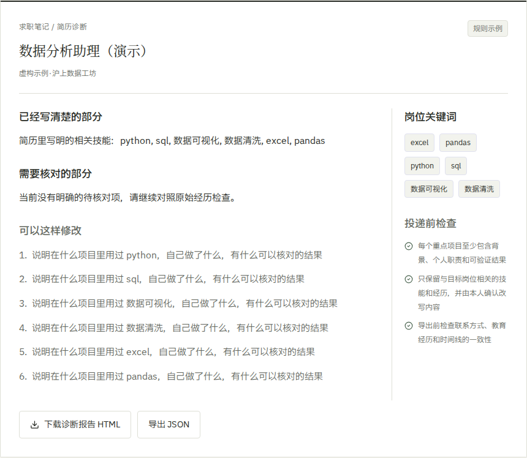

# CareerPilot · 就业罗盘

从一份简历开始：核对经历、比较岗位、修改表达，再练习面试。

[项目源码](https://github.com/CP-bee-git/AI-game) · [部署与模型配置](docs/DIFY.md) · [前端与接口交接](docs/FRONTEND.md) · [职业数据来源](docs/CHINA_CAREER_SOURCES.md)



## 已交付的工作台

- **整理简历**：PDF、DOCX、PNG、JPG，最大10MB；核对技能、教育、项目与城市偏好后确认。可重新修改信息，旧分析随之失效。
- **评分与岗位比较**：DeepSeek按证据评分，职业目录召回后重排；每条建议可查看简历原文及来源。评分不代表录用概率。
- **诊断报告**：千问写作、DeepSeek评审；文档阅读区与岗位关键词、投递检查分栏展示，支持HTML／JSON导出。
- **面试练习**：千问出题、DeepSeek评价、千问复盘；当前问题与回答并排，历史回答按时间线保留，失败可重试。
- **职业咨询**：无需上传简历。工作流模式由管理员配置连接，网页不接收供应商Key。
- **职业影像**：图片／视频界面、单独同意、任务去重与状态查询已实现；当前豆包账号实测受到额度／权限限制，功能关闭，不提交生成。

<details><summary>查看文档式诊断报告（合成示例）</summary>



</details>

## 本机访问

| 页面 | 地址 |
| --- | --- |
| 工作台 | <http://127.0.0.1:3000> |
| Dify控制台 | <http://127.0.0.1:8088> |
| 业务接口 | <http://127.0.0.1:8010/docs> |

本机已安装Dify 1.19.0，11个工作流发布。DeepSeek `deepseek-v4.1-flash` 与千问 `qwen-flash` 共用百炼API Key；豆包仍需要独立Ark凭据。供应商Key和Dify应用Key只保存在服务端私有配置，均不提交Git。

管理员账号和凭据在本机 `.private/dify/admin.json`。请勿把文件、数据库或运行日志上传到公开仓库。

## 启动与停止

环境：Linux、Python 3.12+、Node.js 24+、pnpm 11、Docker、Compose 2.35+。

```bash
./start.sh --setup-only             # 安装项目依赖
./start.sh --dify                   # 构建并安装/启动工作台与后端用户服务
bash dify/services.sh status
bash dify/services.sh stop
```

新机器还需按 [Dify说明](docs/DIFY.md) 安装容器、初始化并导入工作流；应用密钥不存在时不会伪装已连接。已有本机Dify密钥文件时，`./start.sh` 自动选择工作流模式。服务在用户登录后自动恢复；未启用无人登录的linger。

旧版直连模式可执行 `./start.sh --legacy`，需要空闲的3000和8000端口。它保留千问Key会话配置，适合兼容回归；当前交付使用Dify入口。Co-Worker的8000端口不会被新工作台占用。

如需公网演示，可运行 `./scripts/install-cpolar.sh`，私有配置中填入 `CPOLAR_AUTHTOKEN` 后执行 `./start.sh --dify --public`。免费域名随隧道变化，不能把旧地址视为永久在线。公开部署前应配置访问控制，并使用合成或脱敏资料。

## 使用顺序

1. 先点击「载入示例」了解流程，示例数据均为虚构，按规则运行，不消耗模型调用。
2. 阅读数据处理说明，上传脱敏简历；扫描件会通过千问视觉识别。
3. 整理并核对资料，查看五维分析和10个职业方向。
4. 导入1–20个目标岗位，生成诊断、修改简历、练习面试。
5. 下载报告。HTML可在浏览器打印为PDF；JSON保留结构化结果。

原始文件保存在本机。相关文本、扫描图像或回答会进入云模型；Dify运行日志可能保留输入输出。网页清空聊天不等于删除服务端日志。当前为单实例浏览器会话隔离，没有跨设备账户与自动保留期清理；完整说明见网站 `/privacy`。

## 设计与框架

桌面采用步骤导航、主工作区、可折叠记录栏。标题使用本地Noto Serif CJK SC子集，正文使用IBM Plex Sans SC子集；暖白、墨绿配色，禁用发光文字和循环装饰动画。900px以下上下排列，窄屏报告与面试改为单列。`prefers-reduced-motion` 开启时关闭全部动画。

```text
frontend/app/        工作台编排、报告/面试/媒体/资料核对组件、隐私说明
backend/app/         会话隔离、存储、Dify业务适配、Agent工具
dify/workflows/      11个可导入工作流
dify/knowledge/      55条带来源职业条目
scripts/            部署、导入和验证工具
docs/               当前截图、部署说明、接口交接、项目介绍PPT
```

## 验证

```bash
make smoke                         # 模拟云调用、完整业务、职业来源、报告及Dify契约
make check                         # Python、类型、生产构建和差异检查
make e2e                           # 浏览器回归；隔离后端8020，不调用真实付费模型
.venv/bin/python scripts/check_dify_live.py  # 真实Dify合成资料全流程，会消耗云额度
```

浏览器首次使用需 `pnpm --dir frontend exec playwright install chromium`。实际验收和媒体受限情况见 [最终交付说明](docs/DELIVERY.md)。
