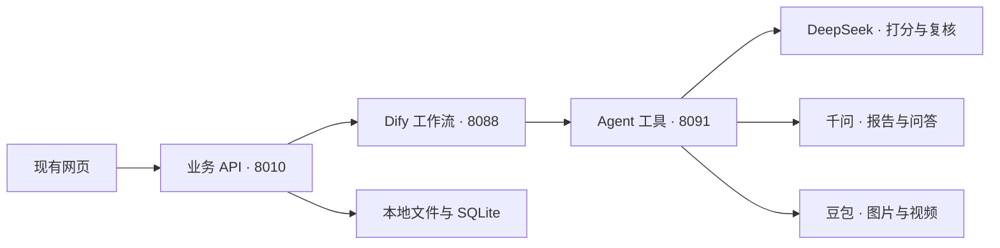

# Dify 后端：结构、启动与验收

2026-11-09。此文是仓库的后端实施说明；前期 `dify-migration-plan.md` 的部署举例以本文为准。

## 1. 当前交付与边界

| 层 | 入口 | 责任 |
| --- | --- | --- |
| 业务 API | `backend/app/main.py`，新实例端口 8010 | 上传、确认、会话隔离、状态存储、报告导出；选择 Dify / 旧云接口 |
| Dify 客户端 | `backend/app/services/dify.py` | Workflow Service API、应用密钥、超时、响应校验；不自动重试付费运行 |
| Dify 业务适配 | `backend/app/services/dify_business.py` | 百分制与星级转换、原文校验、岗位规则约束、评分权重 |
| 工作流 | `dify/workflows/*.yml`，由 `scripts/build_dify_workflows.py` 生成 | 调用次序、评审与一次修订、节点日志 |
| Agent 工具服务 | `backend/app/agent_api.py`，端口 8091 | DeepSeek／千问／Ark 供应商调用、任务契约、OCR、媒体任务 |
| 任务契约 | `backend/app/services/agent_contracts.py` | 五维评分、证据、复核、报告、媒体输入模型 |

本版本使用 Dify 的 HTTP 与 Code 节点编排本机 Agent 工具，**没有第二套 LangGraph 调度循环**。供应商凭据由工具服务从 Co-Worker 的 SQLite 以只读方式取用，或从管理员环境变量取用；提示词及 JSON Schema 在工具服务中版本化。Dify 保存工具 Bearer token，各应用 API Key 存 `.private/dify/app-keys.json`。这与前期方案中“所有供应商 Key／提示词直接存 Dify”不同，目的是先复用本机已验证配置，避免依赖未安装的供应商插件。



当前代码默认 `AI_BACKEND=legacy`，旧入口可继续用。只有显式设置 `AI_BACKEND=dify` 的实例使用新工作流。**Dify 模式不会在故障时偷偷改走旧模型。** 合成演示仍明确使用本地预置数据和规则。

## 2. Agent 与工作流

| 工作流 ID | 节点顺序 | 输出 |
| --- | --- | --- |
| `profile` | 千问结构化 | education / skills / experiences / projects / preferences / warnings |
| `analysis` | DeepSeek 评分 → DeepSeek 复核 → 通过则原样返回，否则修订一次 | 5 个不同维度；每维 0–100，非零分必须有逐字证据 |
| `match` | DeepSeek 多维比较 | 每个输入岗位恰好一项；技能、学历、偏好各 0–100 |
| `report` | 千问报告 → DeepSeek 评审 → 通过则返回，否则千问修订一次 | strengths / must_fix / optional_improve / ats_keywords / checklist |
| `questions` | 千问出题 | 4–6 题与关键词 |
| `evaluate` | DeepSeek 评分与具体反馈 | score 1–5 / feedback |
| `summary` | 千问复盘 | summary 数组 |
| `chat` | 千问职业咨询 | reply；仅接收本次传入的聊天上下文 |
| `ocr` | 千问视觉识别 | text |
| `media_create` | 豆包图片／视频创建 | 任务 ID、状态、结果 URL |
| `media_status` | 豆包视频查询 | queued / running / succeeded / failed |

评分表示材料证据和岗位要求的对应程度，不是能力测验或录用概率。五维星级 = 百分分数 ÷ 20；岗位总分 = 65% 技能 + 20% 学历 + 15% 偏好。学历、城市的已知硬约束仍由业务规则保留，模型不能越过约束把“不满足”改成“满足”。

职业推荐目前是**本地55条目录规则召回10条，再由 DeepSeek 重排**；`dify/knowledge/` 是带来源的可选知识库导入材料，未启用向量检索或嵌入收费。不得将当前实现描述成全库语义检索。内容与使用边界见 `CHINA_CAREER_SOURCES.md`。

## 3. 本机部署

Dify 固定为官方 **1.19.0**，采用其完整 Docker 目录和 Compose 配置。官方要求 Compose **2.35.0+**；不能只复制一个 YAML，因为它还引用 `envs/`、Nginx 和代理模板。源码由 GitHub API 下载，版本和 commit SHA 记录在 `.private/dify/version.json`，不会使用来源不明的同步镜像替换官方服务。

本次主机检查：x86_64，约 14GiB 内存，磁盘剩余约12GiB；**未安装 Docker，当前用户无法无密码 sudo**。已准备部署文件，容器还未启动。建议在首次拉取前保留至少20GiB可用磁盘，避免镜像和数据卷耗尽根分区；此建议不是已执行的清理操作。

### 3.1 安装 Docker（本机管理员终端）

```bash
cd '/home/w-ubuntu/桌面/AI game'
sudo bash dify/install-docker.sh
sudo docker compose version
```

安装脚本使用阿里云 Docker CE 的 Ubuntu 包镜像和官方 GPG 签名，不改写主机原有软件源。镜像拉取先使用官方仓库；若 Docker Hub 不可达，可由管理员把**账号专属、已验证可达的**镜像加速地址合并进现有 `/etc/docker/daemon.json`，不能整文件覆盖，也不把第三方随机镜像地址当成默认可信来源。首次可用 `sudo` 执行 Docker 命令；普通用户访问 Docker socket 需由管理员单独配置。

### 3.2 准备并拉起 Dify

```bash
python3 scripts/prepare_dify.py prepare
sudo bash dify/compose.sh config --quiet
sudo bash dify/compose.sh pull
sudo bash dify/compose.sh up -d
sudo bash dify/compose.sh ps
```

控制台只发布 `127.0.0.1:8088`，HTTPS 备用端口 `8448`。插件调试端口不向宿主机发布。源文件及卷位于 `.runtime/dify/docker/`，凭据位于 `.private/dify/`；均被 Git 忽略。首次生成随机数据库、Redis、插件和 Sandbox 凭据；重复 prepare 保留已有值，不自动轮换。

打开 `http://127.0.0.1:8088/install` 初始化管理员。本机工具地址为 `http://host.docker.internal:8091`；代理仅为该域名允许私网访问，不关闭整套 SSRF 防护。

### 3.3 启动工具与业务服务

```bash
bash dify/services.sh start
bash dify/services.sh status
curl http://127.0.0.1:8010/api/v1/orchestration
```

使用 systemd 用户临时服务保活，避免 shell 结束导致 localhost 消失；主机注销或重启后再执行 start。不会占用 Co-Worker 的8000端口。工具在检测到 Docker 后优先绑定默认 bridge 网关；没有 Docker 时只监听127.0.0.1。安装 Docker 后先 stop 再 start，让工具改绑 bridge 网关。遇到 Docker socket 无访问权限，可以临时指定 `AGENT_TOOLS_HOST` 的桥接地址后在终端运行 `bash dify/run-tools.sh`。

### 3.4 导入工作流并发布

可在 Dify 控制台逐个导入 `dify/workflows/*.yml`（文件采用 JSON 语法，兼容 YAML），填写环境变量 `AGENT_TOOLS_TOKEN`（从私有 `tools.env` 读取）并发布，复制每个应用密钥到 `.private/dify/app-keys.json`。空结构模板见 `dify/app-keys.example.json`。

也提供批量辅助脚本。先在私有文件 `.private/dify/console-session.json` 中保存当前管理员的 Cookie 与 CSRF，格式 `{"cookie":"<完整Cookie>","csrf_token":"<当前CSRF>"}`，权限设600，然后：

```bash
python3 scripts/import_dify_workflows.py --session-file .private/dify/console-session.json
```

脚本按1.19.0源码中的 Console API 编写：导入、发布、生成应用 Key，逐应用落盘以便恢复；已有已配置应用跳过。控制台会话接口可能随版本变化，且本机未启动 Dify，**此脚本与 DSL 尚未经过真实 Dify 导入验证**，须运行 `config`、控制台导入和工作流测试才算完成发布。导入过程中出现版本确认或依赖错误会停止，不忽略错误。操作结束后删除私有会话文件。

## 4. 密钥和媒体

`CO_WORKER_DB_PATH` 默认指向现有 Co-Worker `chat.db`，只读查询配置表，不读取或迁移聊天内容，不改该数据库。显式环境变量 `DASHSCOPE_API_KEY` / `DEEPSEEK_API_KEY` / `ARK_API_KEY` 优先。Dify 模式的网页 `/model/configure` 返回409，供应商凭据不能通过普通业务接口更新。

媒体默认关闭，需要管理员设置 `MEDIA_ENABLED=true` 以及有权限的 `ARK_IMAGE_MODEL` / `ARK_VIDEO_MODEL`，然后重启工具和8010业务服务。当前已有 Ark 文本模型不能当成视频模型使用。目录中存在模型并不能证明生成权限。

POST `/api/v1/media` 接收 `kind`、`prompt`、`consent:true`、16–64位 `request_id`；相同会话和request_id返回已有任务，相同request_id但内容变化返回409。GET `/api/v1/media/{task_id}` 只查询当前会话任务。图片同步完成，视频异步查询。提交超时会记录为 unknown；未知任务不自动重新收费提交。此版本单工具进程；多实例前需将去重锁迁到共享数据库或队列。

生成结果为供应商临时URL，尚未实现永久资产归档或自动续期。显式同意必须由调用方提供；当前没有改前端媒体入口。

## 5. 数据、日志和恢复

- 简历原始文件在本地，解析后的文本会进入本机 Dify 和模型供应商；扫描OCR会把页面图像经 Dify 传给千问。不能承诺“数据不出本机”。Dify 运行日志可能保存输入、引文和输出，需按实际使用设置保留期。
- 默认不会在异常中回显供应商错误正文、Key 或模型原始无效结果。业务接口与工具接口都校验输出。
- `journalctl --user -u careerpilot-agent-tools -u careerpilot-dify-api` 查看本机服务；`sudo bash dify/compose.sh logs --tail 100` 查看容器。
- 画像重新确认、岗位重新导入会清除相应缓存。面试评分成功但总结失败时先保存回答，`POST /interviews/{id}/summary` 可独立重试总结，避免丢失回答再收费评分。
- 停服备份 `.runtime/dify/docker/volumes`、Dify `.env`、`.private/dify`、`backend/storage`；数据库和文件须保持一致。恢复前不能重新生成原部署密钥。
- 回退运行旧业务入口，保持 `AI_BACKEND=legacy`。Dify 尚未就绪时，不修改当前网站的默认启动方式。前端后续只需把内部代理指向8010，并通过 `/orchestration` 展示后端能力。

## 6. 验收状态

| 项目 | 结果 |
| --- | --- |
| DeepSeek 实际短JSON调用 | 通过，使用Co-Worker已存配置 |
| DeepSeek 真实合成简历评分 → 复核 → 输出 | 通过：5个维度、复核通过、逐字引文验证通过 |
| 千问真实合成诊断 → DeepSeek评审 → 千问修订 | 通过：初稿收到修改意见，修订后5个报告字段均通过格式验证；未进行第二次人工内容验收 |
| 千问 实际短JSON调用 | 通过，使用Co-Worker已存配置 |
| Ark 模型目录读取 | 通过；未执行生图／视频，不能算生成验通 |
| 模拟 Dify 完整求职闭环 | 通过：上传、确认、五维、岗位、诊断、面试、总结、导出 |
| 错误脱敏、不自动重试、原文校验、会话隔离、媒体去重 | 自动测试通过 |
| 原有 smoke / 职业来源 / 报告检查 | 通过 |
| 官方 Compose 与本地覆盖配置解析 | 通过，Compose v5.7.0独立二进制验证；选中16个服务、入口仅绑定127.0.0.1 |
| Dify Docker实际启动、DSL实际导入、跨容器工具访问 | 待管理员安装Docker后联调 |

当前8010和8091两个本机服务已启动，`/orchestration` 如实显示全部工作流尚未配置；此时请求真实聊天返回503，不伪装工作流已可用。

检查命令：`make smoke`；部署预检：`python3 scripts/prepare_dify.py doctor`；小额文本及Ark目录实测：`PYTHONPATH=backend .venv/bin/python scripts/check_agents_live.py`（前两项会调用模型计费）。
