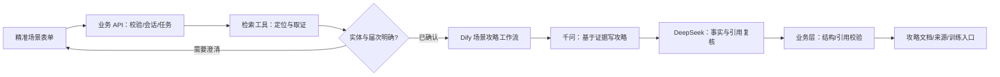

# CareerPilot 交接报告与前端升级方案

交接日期：2026-11-17。项目：就业罗盘 / CareerPilot。工作目录：`/home/w-ubuntu/桌面/AI game`。

**本次交付是规划、设计规范和提示词，不是新功能上线。** 开发者工作台、联网攻略、简历润色编辑器和简历生成器均待实现。接手智能体先核查工作区，再按第九节执行；可复制的任务指令与模型提示词见 [HANDOFF_PROMPTS.md](HANDOFF_PROMPTS.md)。本文最后一节给出开发者入口与目标页面。

## 一、接手目标与产品定位

把现有工作台升级为一个兼顾普通求职者和开发者的专业求职、面试准备平台：用真实经历组织简历，用明确目标定制训练，用可追溯的最新公开资料制定准备攻略。

面向中国校招、社招、技术面试、项目答辩，以及与开发者能力展示相关的算法竞赛、编程比赛、黑客松等场景。比赛模块侧重规则解读、备赛、作品表达与答辩；扩展场景仍服务求职与能力表达，不演变成无边界的通用问答平台。

| 主线 | 用户要完成的事情 | 下一阶段结果 |
| --- | --- | --- |
| 简历指导 | 知道哪里写不清、为何影响岗位对应 | 有原文依据的诊断与提升指南 |
| 简历润色 | 保留事实，改进结构与表达 | 原文/改写对照、修改理由、本人确认 |
| 简历生成 | 从真实经历形成可投递材料 | 可编辑草稿、模板、导出 |
| 面试训练 | 针对岗位与面试环节练习 | 题目、逐题反馈、复盘 |
| 开发者场景攻略 | 定位具体公司/比赛/届次/赛道，快速准备 | 联网查证、来源、行动清单与训练入口 |

“高端大气上档次”落实为清晰的品牌识别、大尺度留白、强弱分明的排版、克制的色彩、可信的结果文档与完整交互状态。视觉方案不能靠添加装饰掩盖流程复杂度。

## 二、当前真实基线与交接注意事项

### 2.1 已实现的能力

| 项目 | 当前情况 | 证据/位置 |
| --- | --- | --- |
| 前端 | Next.js 16.4.6 / React 19，TypeScript | `frontend/package.json` |
| 后端 | FastAPI / SQLite，浏览器会话隔离 | `backend/app/main.py`、`services/session.py` |
| 模型编排 | Dify 工作流调用本机 Agent 工具；另保留 legacy 路径 | `services/dify.py`、`agent_tools.py` |
| 简历 | 上传 PDF/DOCX/PNG/JPG，抽取、人工确认、五维检查 | `page.tsx`、`profile-review.tsx`、`services/profile.py` |
| 岗位与诊断 | 岗位导入、匹配、有证据的诊断、HTML/JSON 导出 | `services/dify_business.py`、`diagnosis.py`、`exporter.py` |
| 面试 | 题目、逐题回答评分、历史反馈、复盘独立重试 | `interview-room.tsx`、`services/interview.py` |
| 职业参考 | 本地 55 个中国职业条目，规则召回后重排 | `backend/app/data/occupations.json` |
| 咨询 | 无需简历；共享中国求职领域和事实约束提示词 | `services/chat.py`、`chat-panel.tsx` |
| 媒体 | 有界面与任务接口，当前关闭 | 不作为此次升级主线 |

### 2.2 尚未实现，不能在交付文案中写成已上线

- 没有浏览网页、搜索引擎工具或已验证的供应商联网能力；当前通用文本调用不能自动搜索实时规则。
- 没有 `/developer` 页面、精确场景表单或引用式攻略报告。
- 没有专用简历润色对照编辑器、事实锁定生成器和原生 DOCX 简历导出。
- 没有开放给第三方调用的开发者 API、API Key 管理或 SDK；“开发者工作台”首先指开发者使用的场景工具。
- 领域专精通过提示词、证据校验和工作流实现，尚未开展基础模型微调；不能宣传为已训练的独立行业模型。

### 2.3 最近验证与运行状态

最近一轮：`make check` 通过，浏览器回归 17/17 通过；真实 Dify/云模型合成业务链路 18/18 通过，用时约 49 秒。这个耗时覆盖多个业务步骤，不是未来联网攻略的延迟指标。本次规划没有重新运行这些测试，也不把历史验收当作永久在线保证。

Docker 网络数据库结构损坏已恢复，13 个 Dify 服务和缺失的容器网络已核对；Next.js 从 16.4.3 升到 16.4.6，升级时生产依赖审计为 0 项已知漏洞。运维细节、备份位置、冷启动说明见 [FRONTEND_RUNNING.md](FRONTEND_RUNNING.md)，不要重新清空 Docker 数据来解决页面问题。

**当前工作区有未提交改动，包括之前已验收的业务提示词、前端文案、安全升级与运行说明。** 接手前执行 `git status --short` 和 `git diff --stat`；不要重置、覆盖或把它们当作可以丢弃的测试文件。`.private/`、`.runtime/`、`.env`、上传文件和业务数据库不进入公开提交或交接附件。

### 2.4 优先阅读与文件入口

1. 运行或排错：读 [FRONTEND_RUNNING.md](FRONTEND_RUNNING.md)。
2. 改页面和调用编排：读 [FRONTEND.md](FRONTEND.md)、`frontend/AGENTS.md`；写 Next.js 代码前读当前依赖内的相关指南。
3. 改工作流：读 [DIFY.md](DIFY.md)、`scripts/build_dify_workflows.py`、`backend/app/services/agent_tools.py`。
4. 改模型输出：先读 `services/chat.py`、`profile.py`、`diagnosis.py`、`interview.py` 和 `agent_contracts.py`，保留严格 JSON 与逐字证据校验。
5. 核对职业来源：读 [CHINA_CAREER_SOURCES.md](CHINA_CAREER_SOURCES.md)，不把职业分类当实时招聘信息。

## 三、前端美观优化方案

### 3.1 当前页面的具体问题

根据当前 1440px 实际页面：模型分工和连接信息占据首屏中段，上传入口位置偏低；主标题与普通模块的尺度差较小；上传空态面积较大而有效信息不多；右栏初始即展示较多“未开始”记录。基础风格清爽，但主次关系不足，用户第一眼更容易注意服务配置而非自己的目标。

CSS 同时存在基础样式和后置覆盖。应整理实际使用的 token 与选择器归属，避免继续叠加一层覆盖文件。保留现有本地中文字体和许可。

### 3.2 推荐视觉方向：专业工作台 + 编辑式报告

采用瓷白主画布、深石墨文字、海军蓝导航和低饱和青绿操作色。深色主要用于导航、场景摘要和重点按钮，结果阅读区保持浅色。香槟色只用于少量细节，不用金色正文来制造“高级感”。

| 设计项 | 建议值 | 使用原则 |
| --- | --- | --- |
| 画布 | `#F6F7F8` | 全局低对比背景 |
| 内容表面 | `#FFFFFF` | 输入、编辑器、报告 |
| 正文 | `#17212F` | 长文与关键数据 |
| 次级文字 | `#586574` | 标签与解释，实测对比度 |
| 导航/重点块 | `#12263D` | 深色侧栏与少量摘要区 |
| 操作强调 | `#176B62` | 主按钮、选中状态、焦点 |
| 轻强调背景 | `#E8F3F0` | 选中项与提示 |
| 细边界 | `#DDE3E9` | 容器分层 |
| 装饰细节 | `#B79C6B` | 少量图形/分隔，不承载小字 |
| 圆角 | 输入 8px，卡片 12px，报告 8px | 减少不同形状混用 |
| 间距 | 8px 基础；区块 24/32/48px | 同类模块一致 |
| 阴影 | 轻微单层，仅用于浮层和重点容器 | 普通区域靠留白分层 |

字号建议：桌面主标题 40–44px/1.3，移动端 28–32px；模块标题 24–28px；正文 15–16px/1.75；辅助文字 13px。保留现有中文宋体用于品牌标题和报告大标题，表单/导航/正文采用 Sans，数据用等宽数字；代码片段才使用等宽字体。

上述值是设计目标，不是已上线样式。实现时实测文本和交互控件对比度，普通正文至少 4.5:1。

### 3.3 首页布局与导航

- 左栏从“只有五个步骤”升级为产品导航：工作台、简历中心、面试训练、场景攻略；原有五步流程保留为任务内进度，不能丢失业务引导。
- 顶栏只显示当前位置、当前任务与简洁服务状态；模型供应商分工收进“服务详情”，点击后可查看，异常时主动显示可操作的错误提示。
- 首屏左侧呈现品牌主张与一个主要行动“开始简历分析”；右侧呈现可读的产品结果示意，明确标“示例”，不展示虚假用户量或录用率。
- 次级入口为“开始面试准备”和“载入示例”；只有一个视觉主按钮。没有简历的用户也能进入独立场景准备。
- 上传区改为紧凑的任务卡，清楚显示文件类型、大小、处理步骤、隐私同意；不扩大空白拖拽区来填充首屏。
- 本次记录在有任务后展开，空态保留轻量说明；窄屏收纳为可展开区域。
- 已关闭的职业影像移入扩展工具说明，不占据求职/简历主路径；能力状态仍保持真实。

### 3.4 结果区与交互细节

简历报告以“结论摘要 → 三项优先动作 → 原文证据 → 详细检查 → 导出”组织。润色对照显示原句、建议句、修改原因、事实来源和逐条采纳按钮。面试区强调当前题目、回答区和逐题反馈，历史记录默认折叠，结束后显示下一轮练习重点。

按钮至少 44px 高；所有输入有可见标签；点击提交后保留用户输入。具备空态、加载、澄清、部分成功、超时、错误、成功及重试状态。进度用实际阶段文本，不使用虚构百分比。过渡 160–220ms；遵守 `prefers-reduced-motion`，长报告不逐段飘动。

桌面宽度 ≥1280px 可用导航/主区/上下文三栏；900–1279px 收纳上下文栏；<900px 主区单列；<620px 对照编辑器上下切换。至少在 1440×900、1280×800、768×1024、390×844、360×800 检查长中文标题、错误信息和下载控件。

## 四、场景产品定义：先精准，再联网，再给攻略

### 4.1 三种类型与条件字段

| 类型 | 必要信息 | 有价值的补充信息 |
| --- | --- | --- |
| 求职 `job_search` | 公司/机构或明确岗位方向、岗位名、校招/社招、目标时间 | JD/官方链接、城市、年级/年限、已有能力、准备时长 |
| 面试 `interview` | 公司/机构或通用训练方向、岗位、面试环节 | 轮次、已知题型、面试日期、用户经历；单位未知时不能推定单位流程 |
| 比赛 `competition` | 比赛全称、届次/年份、赛道、阶段/目标 | 主办方、官方规则链接、组别、截止时间、评分维度、队伍与技术栈 |

公共字段：用户希望解决的问题、准备天数、每天可用时间、已有基础、约束条件。日期/年份不预填成“最新一届”，应由用户输入或明确选择，系统使用服务端当前日期与 Asia/Shanghai 展示时间。

只有“面试”“蓝桥杯”“参加比赛”等输入时，先问 1–3 个影响定位的关键问题；不直接搜索并拼出某一届攻略。用户选择“通用训练”时允许进入通用建议，并显著标明没有定位具体企业/届次。

### 4.2 定位与确认

将自由文本整理为可编辑“场景确认卡”：类型、目标实体、时间/届次、岗位或赛道、环节、目标、准备时间。明确同名实体、不同赛事赛道和往年公告的区别。

用户填写足够具体的信息后可直接开始查证；检索发现多个候选时暂停生成针对性攻略，展示差异并让用户选定。允许先输出通用准备步骤，但不能称为该实体官方攻略。

### 4.3 攻略结果结构

1. **场景已确认项**：对象、岗位/赛道、届次、地区、阶段、检索时间。
2. **已查证要求**：来自官方资料的资格、时间、内容、评审维度；每条关联来源。
3. **准备重点**：对用户基础与目标差距的解释，明确这是建议。
4. **可执行攻略**：按用户可用时间安排任务、产出物、完成标准与优先级。
5. **面试/答辩训练**：建议问题、考察点与回答组织方向；预测题与已公开真题分开。
6. **不确定与冲突**：没有找到的规则、不同来源冲突和必须本人确认的事项。
7. **资料来源**：可点击原始链接、标题、发布/更新时间、抓取时间与支持的结论。

每条备赛/求职任务写清“做什么、产出什么、如何自查”；不使用“一定拿奖”“保过面试”等承诺。规划日程不假定用户已经掌握未提供的技能。

## 五、联网检索与模型实现方案

### 5.1 能力路径与分工

推荐首版沿用现有业务 API → Dify → Agent 工具链路，增加服务端公开信息检索工具和 `scenario_strategy` 工作流。搜索与网页抓取放在后端，面向浏览器只暴露业务接口。不要仅在提示词中写“请联网”或随意加入未经验证的 `enable_search` 参数。



检索供应商尚未选定。接手时根据可用服务端凭据、中文覆盖、官方域名检索能力、计费和实际延迟选一个可用服务；首版只接一个实现，不为多个假想供应商搭建完整框架。没有凭据时明确返回 `search_unavailable`，页面仍可做通用训练但必须显示“未联网核验”。

正文抓取优先使用搜索服务提供的合规正文能力或受控服务端读取。模型不能自行创建来源 URL。检索工具负责来源 ID、原始 URL、可引用片段与时间，模型只选取和引用这些记录。

### 5.2 速度与成本预算（待测目标）

- 输入完整时由业务代码先构造 2–3 条搜索词：精确实体+年份/届次+岗位/赛道，优先官方网站；必要时再扩展同义称呼。
- 搜索与少量页面读取使用有上限的并发；首轮最多整理 6 个候选页面，通常取 3–5 个有效来源。仅找到一个可靠来源也如实输出，不凑来源数。
- 首版一次草稿、一次复核；确有事实错误时最多修订一次。禁止无上限循环搜索、自动重复付费生成。
- 表单提交后 ≤1 秒显示任务反馈。热启动且供应商正常时，完整攻略目标 P50 ≤25 秒、P95 ≤45 秒；单任务总超时上限建议 75 秒。指标需通过后续测量确认，不能在界面承诺已达到。
- 公告、规则缓存与个人攻略分开。公开来源按规范化实体、年份/届次、赛道和 URL 缓存；时间敏感通知初始 TTL 15 分钟，稳定规则 6 小时，可强制更新。显示来源抓取时间，截止日期始终保留原始依据。
- 同一用户相同 `request_id` 重试返回同一任务，内容变化返回冲突；失败后保留表单。服务器重启中断的任务标明中断，不自动重新计费。

### 5.3 来源质量与边界

首选企业招聘官网、赛事主办方/承办机构、学校/政府官方通知、官方规则和公开评分标准。社区经验仅用于辅助练习，标明“经验分享”，不能据此推断当届官方规则或本轮必考题。

检索结果按实体、年份、组别/岗位和地域核对。检索摘要尚未读取正文时只能标 `snippet_only`；不能据此把重要资格和日期标为已核实。来源间冲突时保留差异，优先适用对象一致、明确生效的最新官方公告；无法消解则输出待确认。

基础模型已有知识属于通用知识，不应标成当日检索。网页文本是证据材料，不是新的系统指令。引用检验至少包括来源 ID 存在、链接来自工具、引用片段真实存在及结论与片段相符；后者需要模型评审与抽样人工核对，不能只检查 URL 存在。

只将脱敏的目标实体、时间、岗位/赛道与公开关键词发给搜索服务，简历原文、姓名、电话、证件号和密钥不进入搜索词。用户 URL 的读取须校验协议、解析地址和每次重定向，阻断回环/私网/链路本地/云元数据等目标；保留现有 Dify 到本机工具的受控私网通路，不全局关闭 SSRF 防护。

## 六、简历指导、润色和生成模块

### 6.1 三个动作，使用同一份已确认事实

| 动作 | 输入 | 输出 | 重点 |
| --- | --- | --- | --- |
| 指导指南 | 已确认画像 + 原始证据 + 可选 JD | 优先问题、理由、示范结构、待补充问题、投递检查 | 说明改哪里及为什么 |
| 润色提升 | 选中的原文段落 + 已确认事实 + 目标岗位 | 原句/改写/原因/事实映射/待确认项 | 逐条采纳，可恢复原句 |
| 生成简历 | 已确认画像或用户逐项确认的手填经历 + 模板 | 可编辑分节草稿、遗漏提醒、事实映射、导出 | 事实锁定，用户确认后导出 |

没有简历的用户可手填教育、项目、实习/工作与技能，再确认后生成。手填事实标 `user_confirmed`，不能伪造为原文件证据；项目中没有结果数字时保留定性表述或待补充标记。

### 6.2 用户流程

资料录入/上传 → 核对事实 → 选择目标岗位与模板 → 生成指导/润色/草稿 → 查看原文对照并逐项采纳 → 检查待补充项 → 预览与导出。

首版模板采用“技术校招”和“技术社招”两类，强调项目、技能、个人贡献；预留通用岗位模板只作为后续扩展。校招模板突出教育/课程项目/实践，社招模板突出近期经验/责任范围/可验证成果，不机械要求所有人同一种排序。

### 6.3 事实与版本约束

每条成稿句子关联 `fact_ids`；这些 ID 来自后端保存的来源快照，不由模型定义。后端检查 ID 属于当前会话及当前版本，模型复核句子是否超出所引用事实。提示词不能替代这两层检查。

画像更正、目标岗位变化或原文重新上传后，旧建议标“基于旧版本，需重新生成”，不能悄悄套用。保留原稿、建议稿与采纳状态。用户主动填写的新内容属于自述事实，明确来源，不宣称已验证真实性。

模板和改写不制造学校、职级、证书、工具、方法、工作成果和日期；不把团队成果改为个人成果。导出前单独列出空字段与占位符，用户可以返回补充或明确选择带占位草稿导出；正式投递版阻止未处理占位符进入成稿。

### 6.4 导出范围

首版复用现有 HTML/JSON 导出链路，并支持浏览器打印 PDF。DOCX 简历作为下一步，优先复用项目已有 `python-docx` 能力；模板要验证分页、中文字体回退、可编辑性和 ATS 常见文本提取可读性。现有“支持上传 DOCX/PDF”不等于“已支持生成 DOCX/PDF”。

## 七、拟新增接口与契约

下表全部为建议，尚不存在。保留现有 `/chat`、`/interviews`、`/reports/diagnosis` 契约，避免破坏原页面。

| 接口（前缀 `/api/v1`） | 建议用途 |
| --- | --- |
| `POST /scenario-runs` | 202，提交结构化场景与 request_id，返回 run_id |
| `GET /scenario-runs/{run_id}` | 阶段、结果、澄清项、来源和错误；只读当前会话 |
| `POST /resume-guidance` | 基于来源版本生成结构化指导，复用已有诊断数据 |
| `POST /resume-rewrites` | 对选定段落生成对照润色，不覆盖原文 |
| `POST /resume-drafts` | 从已确认资料生成分节草稿 |
| `PATCH /resume-drafts/{draft_id}` | 保存用户编辑和采纳结果，执行版本冲突检查 |
| `POST /exports` 增补类型 | 指导/攻略/简历导出；保持原 type 行为 |

场景输入至少包含：`request_id`、`type`、`target_name`、`year_or_edition`、`role_or_track`、`stage`、`goal`、`official_urls`、`preparation_days`、`daily_minutes`、`background_summary`。条件必填规则按第四节；`background_summary` 可为空。没有具体实体时显式选择通用模式。

建议场景状态：`queued` → `searching` → `verifying` → `generating` → `reviewing` → `completed`；分支状态为 `needs_clarification`、`partial`、`failed`、`interrupted`。单实例可用现有 SQLite 存储和有并发上限的后台任务，前端每 2 秒查询并在页面销毁时取消轮询；多实例再考虑共享任务队列。

关键结果结构建议：

```json
{
  "run_id": "server-generated-id",
  "status": "completed",
  "scenario": {"type": "competition", "target_name": "用户已确认赛事", "year_or_edition": "用户已确认届次", "role_or_track": "已确认赛道"},
  "retrieval": {"status": "verified", "searched_at": "服务端实际时间", "cache_hit": false},
  "verified_facts": [{"id": "F1", "text": "由真实来源片段支持的要求", "source_ids": ["S1"]}],
  "recommendations": [{"id": "R1", "action": "具体动作", "deliverable": "产出物", "check": "自查标准", "basis_fact_ids": ["F1"]}],
  "practice_questions": [{"question": "练习问题", "kind": "predicted", "reason": "训练目的"}],
  "uncertainties": [],
  "sources": [{"id": "S1", "title": "工具返回的标题", "url": "工具返回的原始URL", "published_at": null, "fetched_at": "服务端实际时间", "kind": "official", "content_status": "full_text", "excerpt": "真实可核对片段"}]
}
```

此 JSON 只描述字段，不可作为假来源的种子数据。通用建议允许 `source_ids` 为空，但不能出现在 `verified_facts` 中。来源列表由工具与后端组装，模型不得补 URL。

简历输入使用已有 `resume_id + source_revision`，或显式确认的手填事实，两者择一。新增结构化契约放进现有 schema 体系；事实清单、版本与来源归属以服务端为准，不能相信客户端声称的原文件证据。

## 八、功能验收清单

| 范围 | 接手智能体必须给出的证据 |
| --- | --- |
| 视觉 | 五种指定视口截图；主 CTA 清晰；长中文、错误态、空态无横向溢出；文字对比度通过 |
| 原有流程 | 上传/确认/岗位/报告/面试/导出不退化；既有 smoke/check/e2e 通过 |
| 精确场景 | 缺年份、同名赛事、不同赛道时正确澄清；不会擅自换成另一届或另一类面试 |
| 联网真实性 | 服务端实际调用记录、真实公开来源链接与抓取时间；断网或缺搜索配置时诚实显示状态 |
| 引用 | 所有“已查证”结论有可核对支持片段；不存在模型自编 source_id/URL；陈旧/冲突信息可见 |
| 建议实用性 | 每个优先任务有动作、产出和自查标准；预测问题不标成官方真题 |
| 简历事实 | 只给 Python/1000 条时不新增库、方法、成果数字；个人与团队成果保持区分 |
| 简历编辑 | 原文保留、逐条采纳/撤销、版本更正失效、占位符提示和导出预览有效 |
| 隔离与重试 | 跨会话读取 404；重复 request_id 不重复计费；任务失败保留输入，重启不偷偷重新提交 |
| 联网工具 | 网页提示注入不改变任务；私网与重定向访问受限；私人简历不进入搜索词 |
| 速度 | 分开记录检索、生成、复核和总耗时；用可复现样本测量目标，失败和冷启动另计，不编造百分位数 |

联网真实样例至少覆盖一项官方招聘场景和一项已明确届次/赛道的开发者比赛，另加一个查无权威资料的失败样例。测试时记录当时查询日期，后续不同届次内容变化不算代码回归。模型输出质量要抽样人工检查，不用“接口 200”代替事实核验。

## 九、实施顺序与任务交接

分工表示任务边界，可由同一智能体依次完成；本报告没有创建或调度其他智能体。

| 阶段 | 交付物 | 建议触及文件 | 完成条件 |
| --- | --- | --- | --- |
| P0：锁定基线 | 工作区变更清单、旧流程复核、设计 token 草案 | 阅读现有文档/配置 | 明确哪些已实现、哪些待做；保留未提交工作 |
| P1：视觉与导航 | 升级首页、紧凑上传、服务详情、可访问导航 | `page.tsx`、`globals.css`、`workspace.css`、共享壳组件 | 指定视口截图与原回归通过；不显示未实现按钮为可用 |
| P2：检索与场景攻略 | 场景表单、检索工具、异步任务、引用报告 | `schemas.py`、新 `services/scenarios.py` / `search.py`、`agent_tools.py`、工作流生成器 | 缺信息/歧义/断网/真实引用/请求去重均通过 |
| P3：简历中心 | 指导、润色对照、两种模板、草稿导出 | `profile-review.tsx`、`report-view.tsx`、新简历页面/服务、`exporter.py` | 事实映射、撤销与版本失效、正式版占位符检查通过 |
| P4：最终接通与验收 | 页尾开发者入口、完整跳转、真实案例、更新运行说明 | `/developer` 及导航、测试、文档 | 第八节逐项有证据，旧测试和真实链路通过 |

P2 可先在 `/developer` 路由开发完整场景能力，但公开入口应在能力就绪后启用。尚未接通的设计稿明确标注原型状态，不静默返回预制攻略。

建议模块职责：`search.py` 只负责公开信息检索/读取与标准化来源；`scenarios.py` 负责场景定位、证据组织、任务状态与攻略编排；现有 `interview.py` 继续负责练习题与评价；简历指导/生成共享已确认事实，不各自重复抽取。不要为这次升级重写全站状态管理或新增第二套调度系统。

### 启动与检查

```bash
cd '/home/w-ubuntu/桌面/AI game'
source "$HOME/.nvm/nvm.sh"
nvm use 24
bash dify/services.sh status
make smoke
make check
make e2e
```

开发/测试不覆盖正式 `.next`，测试使用 3005/8020 和 `.next-test`。当前生产前端 3000 → 业务 API 8010；Dify 控制台 8088；模型工具 8091 绑定 Docker 可访问的桥接地址。工作流图改变时更新生成脚本和 DSL，再导入发布；仅改工具服务提示词时重启工具即可。

## 十、提示词交付与使用方式

配套文件 [HANDOFF_PROMPTS.md](HANDOFF_PROMPTS.md) 包含：总接手指令、视觉改造任务、联网与场景任务、简历模块任务，以及领域总则、场景澄清、证据攻略、复核和简历指导/润色/生成提示词。

开发指令交给实施智能体；产品模型提示词放进服务端源码版本管理，并与 JSON Schema、实际工具输入和后端校验一起使用。不得把“提示词要求联网”作为检索工具实现；不得在同一个提示词中混用“只能根据简历事实”与“可创造候选人经历”。外部要求与用户经历必须分开处理。

## 十一、交付完成后应报告的内容

接手智能体交付时提供：实际变更清单、已上线/仍待开发功能、真实来源案例、目标视口截图、测试结果、联网延迟实测、模型与搜索配置边界，以及可执行的启动/回滚说明。测试结果标明模拟或真实调用，真实调用注明是否计费；不要交付含凭据或真实简历的日志。

本次文档交接仅保存设计与计划，没有更改产品页面、模型行为、部署状态或搜索配置。

## 十二、最后入口：开发者工作台跳转界面

**在首页页尾最后一项添加“开发者工作台 →”，跳转本站 `/developer`。** 左侧导航底部可同步提供次入口；返回键使用“返回求职工作台”。内部路由默认同页跳转，配合方向箭头表达前进，不用假外链图标。它是面向开发者的精准场景准备界面，不是 Dify 管理后台，也不开放服务器密钥。

入口文案：

> 开发者工作台  
> 为技术求职、面试与比赛，定制一份有来源的准备攻略。  
> 进入工作台 →

目标页面的桌面布局：

```text
┌ 就业罗盘 / 开发者工作台                 返回求职工作台 ┐
│ 为一个明确目标，准备下一次表现。                       │
│ 技术求职、面试与比赛：确认场景 → 联网查证 → 行动攻略    │
├─────────────────────┬───────────────────────────────┤
│ 场景定制             │ 场景确认卡 / 攻略文档           │
│ [求职] [面试] [比赛] │ 目标、届次/年份、岗位/赛道、阶段 │
│ 目标公司/比赛全称    │ 检索状态与更新时间              │
│ 年份/届次、岗位/赛道 │ 已查证要求 + 可点击来源          │
│ 面试环节/比赛阶段    │ 优先动作与阶段产出              │
│ 官方链接（可选）     │ 面试/答辩练习题                 │
│ 我的基础、准备时间   │ 待确认项 / 来源列表             │
│ [生成专属攻略]       │ [开始练习] [查看简历提升指南]    │
│ 输入不够 → 关键追问  │ [导出攻略]                      │
└─────────────────────┴───────────────────────────────┘
```

左侧使用条件表单，右侧以文档为主，不做代码终端风格。比赛选择后显示届次、赛道、组别与阶段；面试选择后显示岗位、招聘类型与环节。手机上先表单后结果，结果顶部固定一个轻量“修改场景”按钮。

“生成专属攻略”仅在所需字段满足时可提交；缺少联网能力时改为明确标注的通用模式。生成完成后，“开始练习”承接已确认场景与题型；“查看简历提升指南”承接相关岗位目标，附带用户自己确认的资料；未上传简历时引导手填或进入简历中心，不直接替用户生成经历。

此节为最终目标界面与跳转约定，目前 `/developer` 尚未创建，页尾入口也尚未添加；由下一阶段实施智能体按本报告接通并验收。
